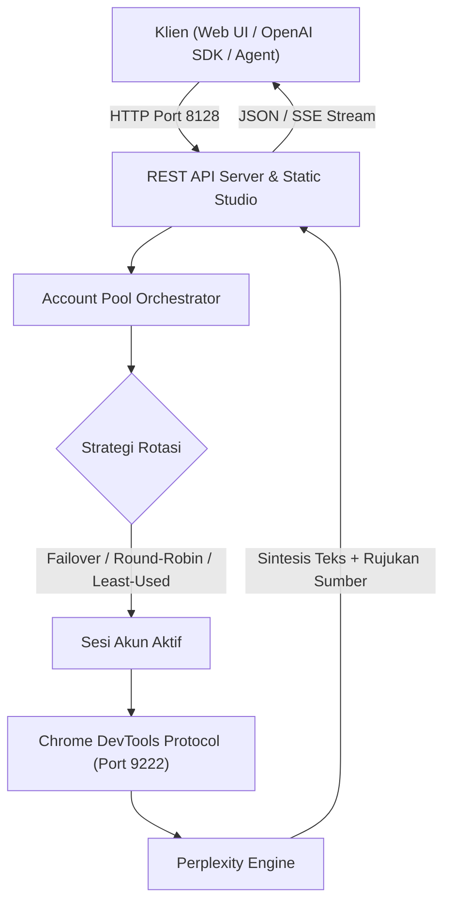

# Open Perplexity Farm & Web Studio

[](https://opensource.org/licenses/MIT)
[](https://nodejs.org/)
[](https://platform.openai.com/docs/api-reference)

Open Perplexity Farm & Web Studio adalah mesin pencarian AI self-hosted dan orkestrator multi-akun yang terhubung ke mesin Perplexity AI melalui Chrome DevTools Protocol (CDP). Proyek ini menyediakan antarmuka web responsif dan REST API yang kompatibel dengan format OpenAI (`/v1/chat/completions`).

---

## Fitur Utama

- **Orkestrasi Multi-Akun**: Rotasi akun otomatis saat terkena limit kuota dengan fallback instan (<0.5 detik).
- **Strategi Distribusi Beban**: Mendukung mode `FAILOVER_ONLY`, `ROUND_ROBIN`, dan `LEAST_USED`.
- **Pembuatan Akun Otomatis**: Generator akun bawaan menggunakan disposable inbox dan otomasi sesi browser.
- **Antarmuka Web**: UI responsif dengan visual kontras tinggi, panel sumber terverifikasi, dan visualisasi rumus KaTeX.
- **Fokus Pencarian**: Mendukung mode Web, Akademik (jurnal ilmiah), Penulisan teks, YouTube, dan Reddit.
- **Ekspor Sitasi APA 6th**: Format daftar pustaka otomatis siap pakai untuk naskah ilmiah dan jurnal.
- **API Kompatibel OpenAI**: Dapat digunakan langsung sebagai drop-in replacement pada SDK OpenAI, Cursor, LibreChat, atau tools agentic lainnya.

---

## Arsitektur Sistem



---

## Panduan Penggunaan

### 1. Prasyarat
- Node.js versi 18 atau lebih baru.
- Google Chrome atau Chromium browser terpasang pada sistem.

### 2. Instalasi
```bash
git clone https://github.com/itzluthfi/open-perplexity-farm.git
cd open-perplexity-farm
npm install
```

### 3. Konfigurasi Lingkungan
Salin file `.env.example` menjadi `.env`:
```bash
cp .env.example .env
```

Variabel konfigurasi yang tersedia:
```env
PORT=8128
CDP_PORT=9222
ROTATION_STRATEGY=FAILOVER_ONLY
AUTO_SPAWN=true
```

### 4. Menjalankan Layanan
```bash
# Menjalankan server gateway dan web studio
npm start

# Menjalankan interactive terminal UI
npm run tui
```

Akses Web Studio melalui browser di `http://localhost:8128`.

---

## Perintah CLI (`bin/cli.mjs`)

Aplikasi menyediakan antarmuka CLI untuk manajemen pool akun dan pengetesan:

```bash
# Menampilkan status seluruh akun dalam armada
node bin/cli.mjs pool

# Membuat akun Perplexity baru secara otomatis ke pool
node bin/cli.mjs create 1

# Memindahkan sesi aktif ke akun berikutnya
node bin/cli.mjs rotate

# Menguji kueri pencarian dari terminal
node bin/cli.mjs test "Analisis arsitektur adapter pattern"
```

---

## Referensi REST API

### 1. Chat Completions
`POST /v1/chat/completions`

**Request Body:**
```json
{
  "model": "perplexity/sonar-web",
  "focus": "academic",
  "messages": [
    {
      "role": "user",
      "content": "Jelaskan metodologi Personal Extreme Programming (PXP)"
    }
  ],
  "stream": false
}
```

**Response Body:**
```json
{
  "id": "chatcmpl-1791615000000",
  "object": "chat.completion",
  "choices": [
    {
      "index": 0,
      "message": {
        "role": "assistant",
        "content": "Personal Extreme Programming (PXP) adalah metodologi..."
      }
    }
  ],
  "sources": [
    {
      "title": "Penerapan Personal Extreme Programming",
      "url": "https://journal.example.ac.id/article/view/123",
      "domain": "journal.example.ac.id"
    }
  ]
}
```

### 2. Status Armada Akun
`GET /v1/accounts`

Mengembalikan daftar akun terdaftar, status operasional (`active` atau `cooling_down`), kuota penggunaan, dan metrik agregat.

### 3. Rotasi Akun
`POST /v1/accounts/rotate`

Memicu pergantian akun aktif di sesi browser ke akun berikutnya berdasarkan pool database.

### 4. Pengaturan Strategi Rotasi
`POST /v1/accounts/strategy`

**Request Body:**
```json
{
  "strategy": "LEAST_USED"
}
```

Pilihan nilai: `FAILOVER_ONLY`, `ROUND_ROBIN`, `LEAST_USED`.

### 5. Health Check
`GET /health`

---

## Integrasi SDK

### Python (`openai` SDK)
```python
from openai import OpenAI

client = OpenAI(
    base_url="http://localhost:8128/v1",
    api_key="not-needed"
)

response = client.chat.completions.create(
    model="perplexity/sonar-web",
    messages=[{"role": "user", "content": "Jelaskan prinsip SOLID pada rekayasa perangkat lunak."}]
)

print(response.choices[0].message.content)
```

### Node.js (`openai` package)
```javascript
import OpenAI from "openai";

const client = new OpenAI({
  baseURL: "http://localhost:8128/v1",
  apiKey: "not-needed"
});

const res = await client.chat.completions.create({
  model: "perplexity/sonar-web",
  messages: [{ role: "user", content: "Apa perbedaan TCP dan UDP?" }]
});

console.log(res.choices[0].message.content);
```

---

## Lisensi
Didistribusikan di bawah lisensi [MIT](LICENSE).
